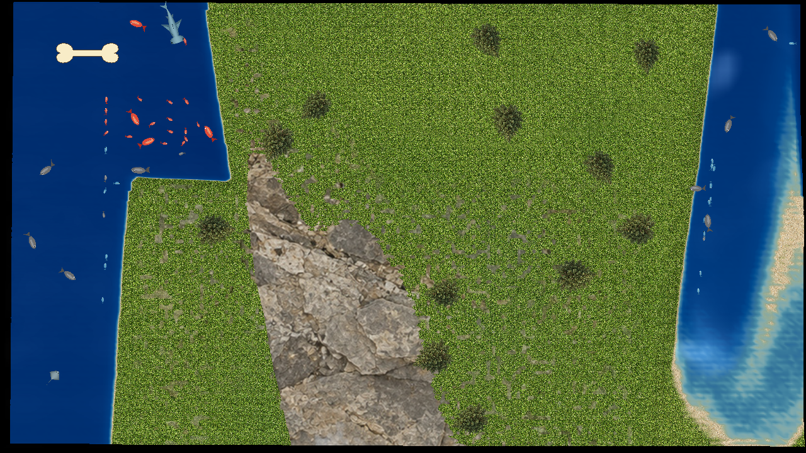
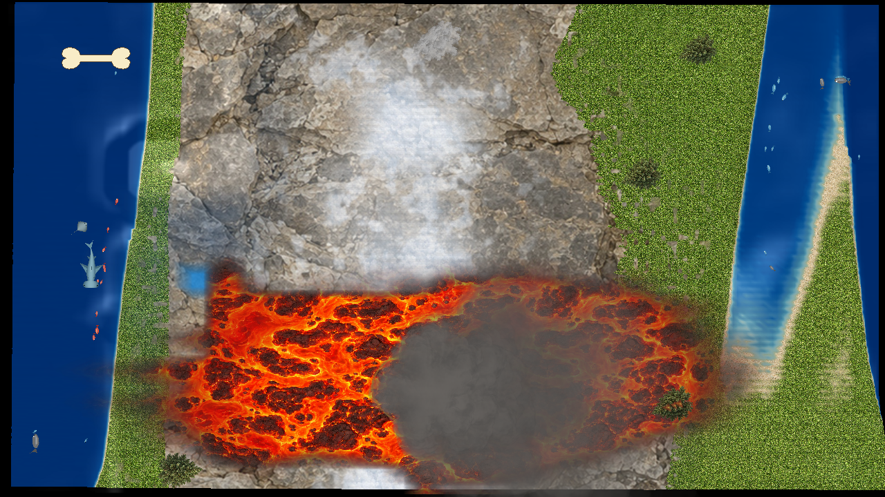
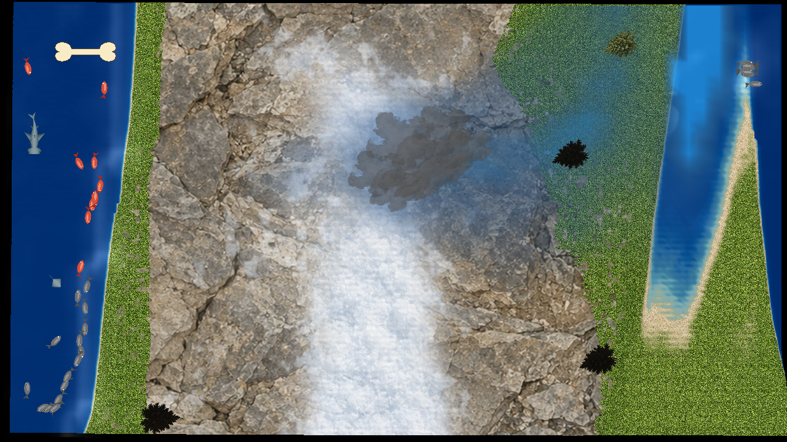

# TopoPlay

**TopoPlay** turns a box of sand into an interactive landscape using a Kinect v2
and a projector. Build mountains, dig rivers, collect rainwater, erupt volcanoes,
and uncover buried fossils. The projected terrain responds as you shape the sand.

TopoPlay is designed for hands-on exploration in classrooms, school events, and
other educational settings. Its water effects are interactive approximations,
not tools for quantitative hydrology.



*TopoPlay projector output. This is a software screenshot, not a photograph of a physical sandbox.*

## What you can do

- Shape terrain with adjustable textures, elevation colors, snow, and vegetation.
- Make rain, build ponds and dams, dig drainage channels, and create waves.
- Explore water with fish, sharks, and stingrays.
- Build a volcano with a countdown, sound, smoke, and flowing lava.
- Reveal fossils and buried artwork with Fossil and Dig modes.
- Use projected gesture buttons and idle demonstrations.
- Save your box calibration, appearance, and controls for the next session.

## Screenshots

| Volcano | Rain and clouds |
| --- | --- |
|  |  |
| Lava and smoke spread across the landscape. | A storm cloud brings rain to the landscape. |

Both images show projector output. See the [user guide](docs/USING_TOPOPLAY.md)
for the control window and illustrated demonstrations.

## What you need

| Component | Requirement |
| --- | --- |
| Computer | A 64-bit x86 PC running Ubuntu desktop with working OpenGL graphics |
| Depth camera | Kinect v2 with its power/USB adapter and a USB 3 connection |
| Projector | A projector and video connection suited to your box size and mounting distance |
| Sandbox | Sand with a rigid camera/projector mount |
| Build tools | Python 3, GCC/G++, Make, CMake, Git, and pkg-config |
| Framework | openFrameworks **0.12.1**, Linux 64-bit release package |
| Kinect driver | Standard **libfreenect2** with OpenGL support |
| Libraries | OpenCV, OpenGL/GLU/GLEW/GLFW, libusb, TurboJPEG, font/X11 libraries, and openFrameworks dependencies |
| Addons | ofxCv, ofxDatGui, ofxModal, ofxParagraph, ofxOpenCv, and ofxXmlSettings |

The installation guide provides package commands, dependency versions, and the
two addon compatibility patches. Microsoft's Windows Kinect SDK is not needed
for the Ubuntu installation.

## Install TopoPlay

**[Follow the Ubuntu installation guide](docs/INSTALL_LINUX.md).**

This repository provides source code, build scripts, and runtime assets. Build
TopoPlay before running the installer; a compiled application is not included
in the source download. The build checks for common missing dependencies and
prints setup guidance, but does not install dependencies automatically.

The guide covers downloading the source, preparing Ubuntu, installing
openFrameworks and addons, testing the Kinect, building TopoPlay, and creating
an application-menu entry or desktop shortcut.

After dependencies are installed, the build commands are:

```bash
bash scripts/build.sh --of-root /path/to/openFrameworks \
    --freenect2-root /path/to/libfreenect2
./TopoPlay
```

Run these commands from the TopoPlay source folder. Replace the example paths
with your actual dependency folders. Keep build paths free of spaces.

After a successful build, install a separate application copy with:

```bash
python3 scripts/install.py
```

Choose the parent folder for your installation, then choose whether to add a
desktop shortcut. Start the installed application from its menu entry, shortcut,
or `TopoPlay` launcher. No automatic startup entry is created.

## First use and settings

1. Connect the Kinect and projector. Use an extended desktop for the projector.
2. Fix the projector's orientation and mount before calibration.
3. In Setup, draw the sandbox's region of interest (ROI) around the usable sand.
4. Calibrate the lower surface, then follow the prompt for a flat board at least
   **30 mm closer to the Kinect**. Remove the board after calibration succeeds.
5. Enter **RUN**, check the alignment, and select **Save box settings**.
6. Close and reopen TopoPlay to check that the settings were saved.

Setup and calibration default to the color camera view. You can switch to depth
with the camera-view controls. RUN shows the projected terrain/map.
Recalibrate after moving the camera/projector mount or changing image orientation.

See **[Using TopoPlay](docs/USING_TOPOPLAY.md)** for calibration details, gesture
buttons, fossils, custom images, settings, and shortcuts. Close the main control
window to quit both windows and release the Kinect.

## Compatibility and known limitations

TopoPlay has been tested on a Dell Inspiron 5570 with an Intel Core i7-8550U,
Ubuntu, Kinect v2, and a 1280 × 720 projector. This is a tested configuration,
not a minimum hardware specification. Windows, macOS, and ARM are not validated.

The standard Kinect driver has passed startup, fresh calibration, RUN, and
shutdown testing. A complete installation on fresh Ubuntu using newly obtained
framework/addon dependencies remains unverified. Performance and cooling depend
on the computer, camera ROI, render resolution, and enabled effects.

Idle-demo ocean ripples may appear inactive. Optional legacy Island/Map and
competitive Sandimals activities are not included in the supported feature set;
their media is not bundled, and missing-resource messages may appear.

See [troubleshooting](docs/INSTALL_LINUX.md#10-troubleshooting) for installation
and startup problems, and the [validation record](docs/STANDARD-DRIVER-VALIDATION.md)
for test details.

## Documentation and help

- [Ubuntu installation and troubleshooting](docs/INSTALL_LINUX.md)
- [Using TopoPlay](docs/USING_TOPOPLAY.md)
- [Dependency versions and patches](dependencies/README.md)
- [Technical Linux build notes](docs/BUILD_LINUX.md)
- [Updates, backups, and removal](docs/INSTALL_LINUX.md#9-updates-backups-and-removal)
- [Release history](CHANGELOG.md)

For help, [open an issue](https://github.com/TopoPlay/TopoPlay/issues) with your
Ubuntu version, hardware, what you expected, and what happened. For build
failures, include the first error and relevant nearby lines. Review logs for
personal information before sharing them.

## Credits and licenses

TopoPlay is an independently maintained educational fork of
[Magic-Sand](https://github.com/thomwolf/Magic-Sand), by Thomas Wolf and
Rasmus R. Paulsen, drawing on Oliver Kreylos's UC Davis/KeckCAVES
[AR Sandbox](https://arsandbox.ucdavis.edu/) and Gene Kogan's calibration work.

Source licensing is described in [COPYING](COPYING). Third-party components,
fonts, and media retain their own notices and permissions; see
[Credits](CREDITS.md) and [Assets](ASSETS.md).
Thunder audio is by **Friendly Free Sounds**, credited in those records.
