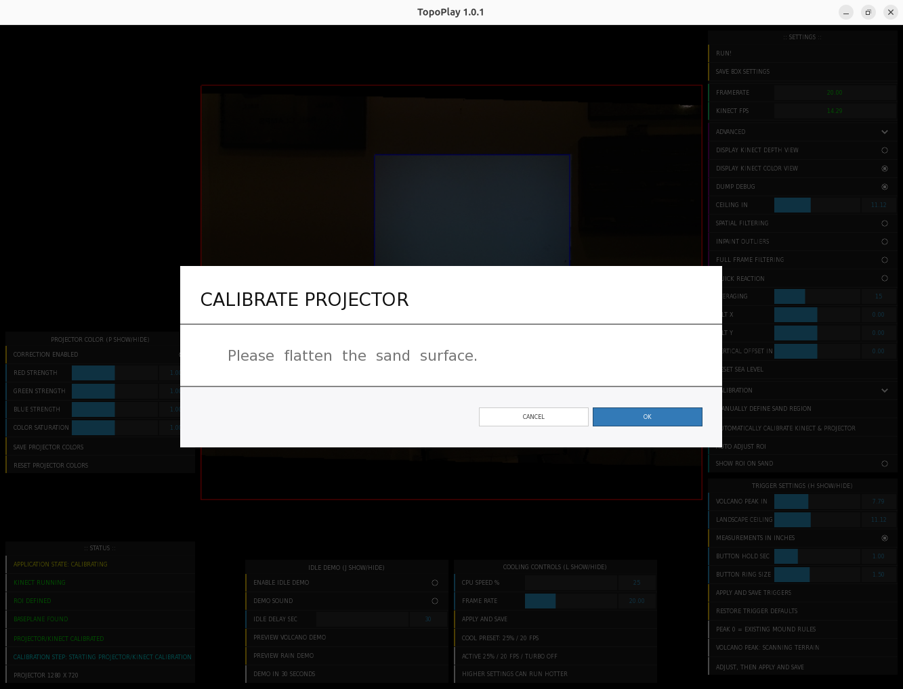
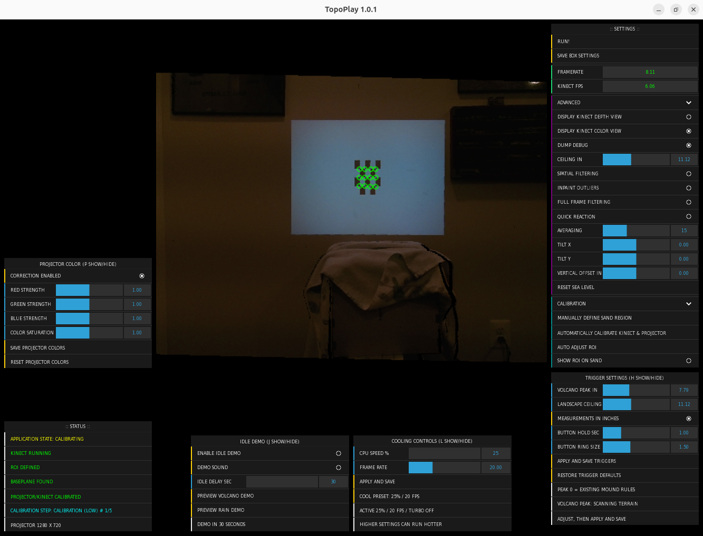
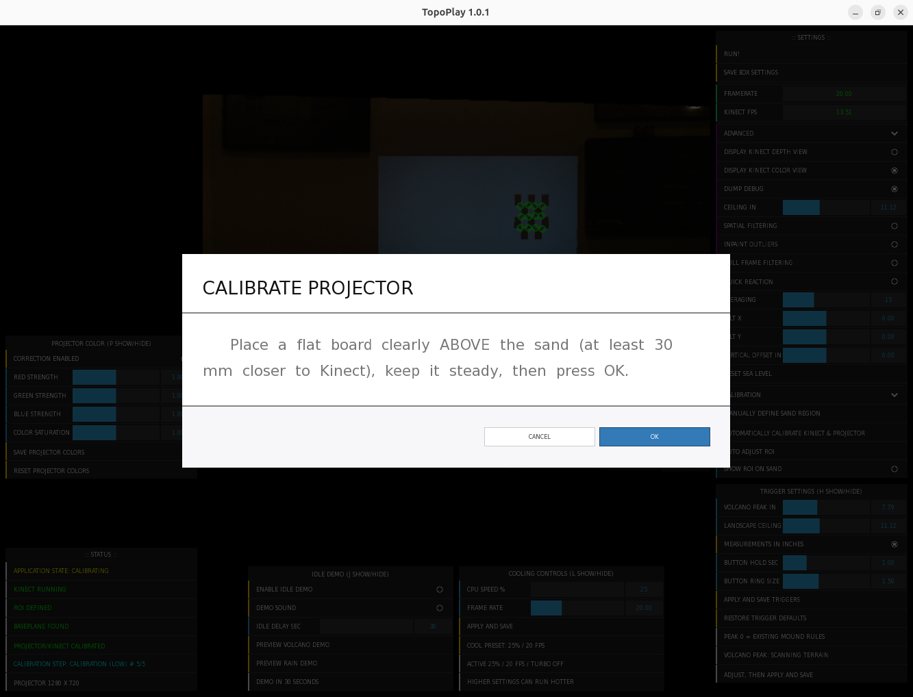
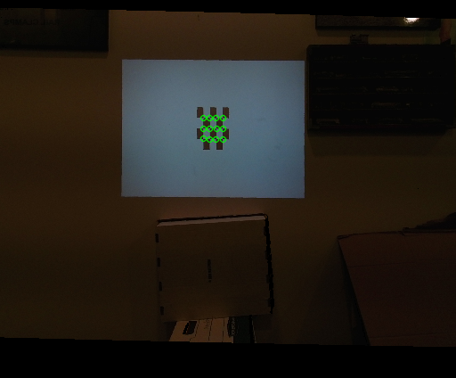
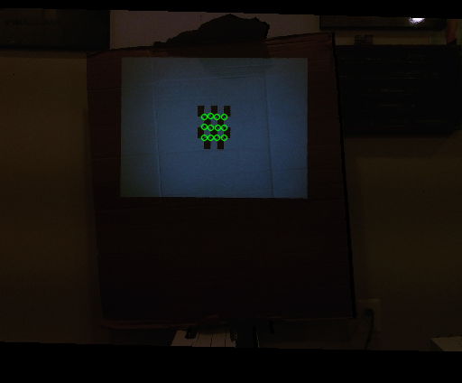
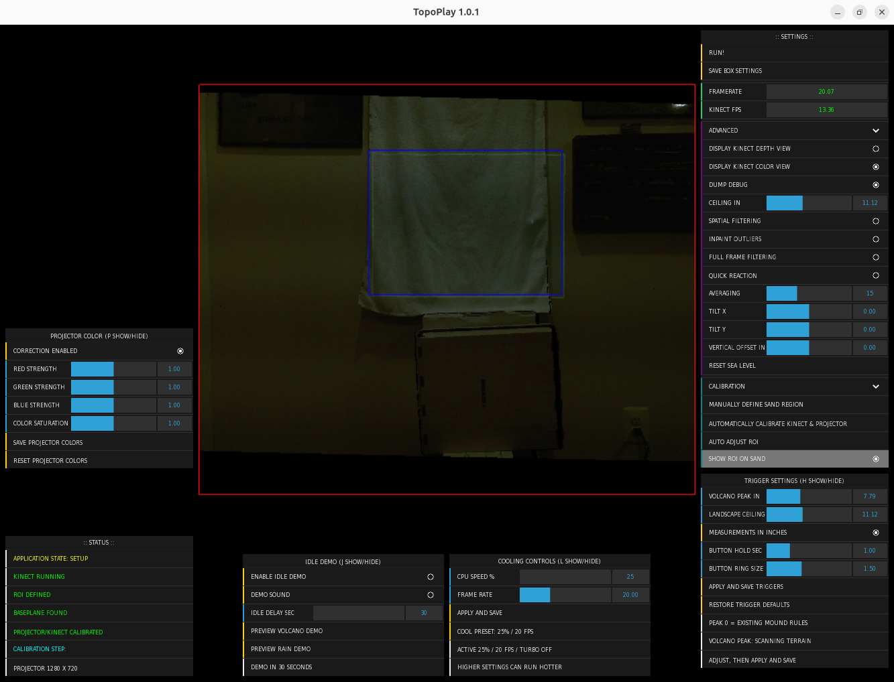
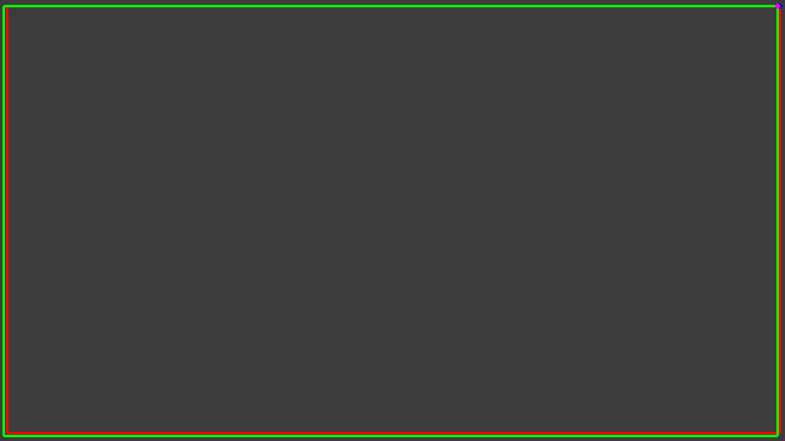
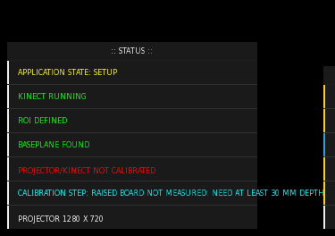
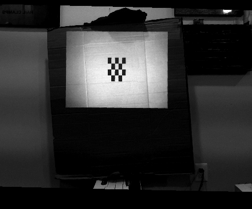

# Install TopoPlay on Ubuntu Linux

This guide takes you from a source download to a locally installed application,
including dependencies, Kinect testing, building, calibration, and updates.

TopoPlay uses standard upstream libfreenect2 without application-specific driver
patches. The former custom RGB-decoding helper has been removed. The standard
driver was built and tested on the operator's existing Ubuntu laptop, including
fresh calibration, RUN operation, and shutdown. A complete fresh-Ubuntu build
with newly obtained framework/addons is still unverified; see
[the validation record](STANDARD-DRIVER-VALIDATION.md).

## Contents

1. [Hardware and platform](#1-hardware-and-platform)
2. [Folders and source download](#2-folders-and-source-download)
3. [Ubuntu packages](#3-ubuntu-packages)
4. [openFrameworks and addons](#4-openframeworks-and-addons)
5. [Kinect driver and permissions](#5-kinect-driver-and-permissions)
6. [Dependency check and build](#6-dependency-check-and-build)
7. [First launch and calibration](#7-first-launch-and-calibration)
8. [Install and create shortcuts](#8-install-and-create-shortcuts)
9. [Updates, backups, and removal](#9-updates-backups-and-removal)
10. [Troubleshooting](#10-troubleshooting)
11. [Validation and references](#11-validation-and-references)

## 1. Hardware and platform

Use an Ubuntu desktop session on a 64-bit x86 PC, a Kinect v2 with its power/USB
adapter, a USB 3 connection, and a projector. Mount the camera and projector
rigidly above the sand. Kinect v1/Xbox 360 sensors use a different driver and are
not supported by this build. Configure the projector as an extended display.

The recorded working system is a Dell Inspiron 5570, Intel Core i7-8550U,
Ubuntu 26.04.1, and openFrameworks 0.12.1. These are observed versions, not minimum
requirements or a promise of compatibility with every Ubuntu release. See
[the dependency record](../dependencies/README.md) for compiler/library versions.
Windows, macOS, ARM, and a headless/server installation are not validated here.

The tested application frame-rate setting was 15 FPS. Larger boxes, different
render resolutions, and different computers need their own performance test.
Keep airflow clear and test temperatures during extended use. The installer
does not change CPU boost settings, power management, or startup behavior.

## 2. Folders and source download

Run commands one block at a time, in order. Stop if a command fails.
`~` and `$HOME` mean your Home folder (for example `/home/yourname`); there
is no second username folder to open inside Home. Use `sudo`
only where shown; build and run TopoPlay as your normal user. Internet access and
administrator rights are needed to obtain dependencies and install Ubuntu
packages. This guide uses the following example folders:

| Folder | Purpose |
| --- | --- |
| `~/TopoPlay-build/TopoPlay` | TopoPlay source checkout or extracted ZIP |
| `~/TopoPlay-build/openFrameworks` | Extracted openFrameworks 0.12.1 package |
| `~/TopoPlay-build/libfreenect2` | Standard Kinect driver source/build |
| `~/Applications/TopoPlay` | Example installed application destination |

Keep source and dependency paths free of spaces and make-special characters.
The final installed application folder may contain spaces. An existing working
setup can keep its current paths; substitute those paths in the commands.

Install the download/build tools first:

```bash
sudo apt update
sudo apt install build-essential git cmake pkg-config python3 unzip
mkdir -p "$HOME/TopoPlay-build"
```

Choose **one** source-download method, using an empty destination.

**Git:**

```bash
git clone https://github.com/TopoPlay/TopoPlay.git "$HOME/TopoPlay-build/TopoPlay"
```

**GitHub ZIP:** open [the repository](https://github.com/TopoPlay/TopoPlay), choose
**Code → Download ZIP**, and extract it. Rename/move the extracted project folder
to `~/TopoPlay-build/TopoPlay`. Keep the whole folder, including `bin/data`,
`dependencies`, `licenses`, and `scripts`. Do not run the build inside the ZIP.
A source download does not include `bin/TopoPlay`; the build creates it.

Check that you are in the right folder and that recorded package files match:

```bash
cd "$HOME/TopoPlay-build/TopoPlay"
ls README.md addons.make scripts/build.sh
python3 scripts/verify-package.py
```

If the last command reports a mismatch on a fresh download, stop and obtain a
complete fresh copy. A ZIP of individual development fixes is not a full source
release. Keep any existing working installation separate from this source tree.

## 3. Ubuntu packages

Install the common libraries checked by TopoPlay, plus Kinect build prerequisites:

```bash
sudo apt install libopencv-dev libgl1-mesa-dev libglu1-mesa-dev \
    libglew-dev libglfw3-dev libusb-1.0-0-dev libturbojpeg0-dev libjpeg-dev \
    libfreetype6-dev libharfbuzz-dev libx11-dev libxrandr-dev \
    libxxf86vm-dev libxi-dev libxcursor-dev libxinerama-dev
```

These packages provide OpenCV, OpenGL/GLU/GLEW/GLFW, USB, JPEG decoding, fonts,
and desktop window support. The openFrameworks installer in section 4 installs
additional framework dependencies, including its media stack. Package names can
change between Ubuntu releases. If APT cannot find a package, resolve that error
using your release's package information before continuing; do not silently skip
it or change the operating-system version files to fool an installer.

For the graphical folder picker and graphics diagnostics:

```bash
sudo apt install python3-tk zenity mesa-utils python3-gi gir1.2-glib-2.0
glxinfo -B
```

Run graphics diagnostics from the desktop session. TopoPlay and its Kinect
processing require working desktop OpenGL; a detected library alone does not
verify a functioning GPU driver. CUDA, OpenNI2, and Microsoft's Windows Kinect
SDK are not installation steps for this Ubuntu setup.

## 4. openFrameworks and addons

### Install and compile the framework

Download the **Linux 64-bit openFrameworks 0.12.1 release package** from the
[official download site](https://openframeworks.cc/download/). If the main page
offers a newer release, use its older-release links to obtain 0.12.1. The recorded
package is named `of_v0.12.1_linux64_gcc6_release`; the `gcc6` part of the archive
name does not require changing your compiler to GCC 6.

Extract it and place the extracted contents in
`~/TopoPlay-build/openFrameworks`. This must be the folder containing `addons`,
`libs`, `scripts`, and `examples`, not an extra enclosing archive folder. Use the
release package rather than a bare GitHub source ZIP, which may lack packaged
libraries.

```bash
cd "$HOME/TopoPlay-build/openFrameworks"
ls scripts/linux/ubuntu/install_dependencies.sh
sudo bash scripts/linux/ubuntu/install_dependencies.sh
bash scripts/linux/compileOF.sh -j2
```

The dependency script changes system packages. Read its output and resolve any
failures before compiling. The project generator is not needed for TopoPlay's
existing Makefile. See [official Linux setup](https://openframeworks.cc/setup/linux-install/)
for framework-specific problems.

### Install all six addons

| Addon | How to obtain it |
| --- | --- |
| `ofxCv` | Clone the repository below and select the recorded commit |
| `ofxDatGui` | Clone, select the recorded commit, then apply the supplied patch |
| `ofxModal` | Clone, select the recorded commit, then apply the supplied patch |
| `ofxParagraph` | Clone and select the recorded commit |
| `ofxOpenCv` | Included with the matching openFrameworks package |
| `ofxXmlSettings` | Included with the matching openFrameworks package |

The following commands are for a **new dependency tree**. Do not run them over
your working laptop's addons. If a destination exists, inspect it first rather
than overwriting it. Run each clone/checkout pair separately and stop on error:

```bash
cd "$HOME/TopoPlay-build/openFrameworks/addons"
git clone https://github.com/kylemcdonald/ofxCv.git ofxCv
git -C ofxCv checkout --detach 209a3986a8f8e1928c7a11f6e1c5d8ea5406e639
```

```bash
cd "$HOME/TopoPlay-build/openFrameworks/addons"
git clone https://github.com/thomwolf/ofxDatGui.git ofxDatGui
git -C ofxDatGui checkout --detach 0c2230afa68fe5dea822932f6b4c178778af9440
```

```bash
cd "$HOME/TopoPlay-build/openFrameworks/addons"
git clone https://github.com/braitsch/ofxModal.git ofxModal
git -C ofxModal checkout --detach 71bfaa283407bbe58b921fd581d8665f21cf5eb8
```

```bash
cd "$HOME/TopoPlay-build/openFrameworks/addons"
git clone https://github.com/braitsch/ofxParagraph.git ofxParagraph
git -C ofxParagraph checkout --detach 41dbfd2e07e00e358629d470dd1b6f986dee2b70
```

These revisions were recorded from the operator's working tree and verified
available as the four listed repositories' HEAD revisions on 2026-10-25.
If a checkout fails, stop and report the addon name and error. Do not substitute
the latest commit and assume compatibility. The included
`dependencies/tested-addon-sources` folders are reference snapshots, not complete
replacement addon distributions: some external libraries/data are omitted.

Check and apply the two compatibility patches:

```bash
cd "$HOME/TopoPlay-build/openFrameworks/addons/ofxDatGui"
git apply --check "$HOME/TopoPlay-build/TopoPlay/dependencies/patches/ofxDatGui.patch"
git apply "$HOME/TopoPlay-build/TopoPlay/dependencies/patches/ofxDatGui.patch"
```

```bash
cd "$HOME/TopoPlay-build/openFrameworks/addons/ofxModal"
git apply --check "$HOME/TopoPlay-build/TopoPlay/dependencies/patches/ofxModal.patch"
git apply "$HOME/TopoPlay-build/TopoPlay/dependencies/patches/ofxModal.patch"
```

If `--check` fails, do not run the following apply command. The patch may already
be applied or the checkout may differ. See [the dependency record](../dependencies/README.md).
Keep the bundled dlib headers in `src/KinectProjector/libs`; no separate dlib SDK
or old `ofxKinect` addon is needed for this integration.

## 5. Kinect driver and permissions

### Build standard upstream libfreenect2

Obtain the driver from [OpenKinect](https://github.com/OpenKinect/libfreenect2#linux)
into an empty folder. Keep an existing working driver separately until testing
passes. These commands build locally; no `sudo make install` is needed for the
explicit driver paths used by TopoPlay:

```bash
cd "$HOME/TopoPlay-build"
git clone https://github.com/OpenKinect/libfreenect2.git libfreenect2
cd libfreenect2
git checkout --detach fd64c5d9b214df6f6a55b4419357e51083f15d93
git rev-parse HEAD
cmake -S . -B build -DCMAKE_POLICY_VERSION_MINIMUM=3.5 \
    -DENABLE_OPENGL=ON -DENABLE_OPENCL=OFF -DENABLE_CUDA=OFF -DENABLE_VAAPI=OFF
cmake --build build -j2
```

The pinned commit is the unmodified upstream source built during the recorded
hardware test. `CMAKE_POLICY_VERSION_MINIMUM=3.5` addresses newer CMake versions
rejecting the project's older policy minimum, without editing the driver.
OpenCL, CUDA, and VAAPI are disabled in this tested configuration, leaving the
OpenGL processing path available. Keep the printed revision with your results.
Changing the upstream commit or enabled processors requires another test.

TopoPlay's application-side switch controls whether it performs color
registration/conversion. The driver continues decoding RGB; RUN drains unused
color frames. CPU use can differ from the earlier optimized custom driver, so
measure temperature and responsiveness on your setup.

### USB permissions and camera test

From the **standard driver's source folder**, install its supplied device rule:

```bash
cd "$HOME/TopoPlay-build/libfreenect2"
sudo install -m 644 platform/linux/udev/90-kinect2.rules /etc/udev/rules.d/90-kinect2.rules
sudo udevadm control --reload-rules
```

Unplug/reconnect the Kinect's USB cable with its power adapter connected. Test it
in the local desktop session as your normal user:

```bash
cd "$HOME/TopoPlay-build/libfreenect2"
./build/bin/Protonect gl
```

Confirm live color and depth images, then close Protonect before starting
TopoPlay. Do not run both applications against the same sensor. USB 2 is insufficient; plug into USB 3 directly while diagnosing connection
problems. A successful camera test is separate from successful calibration.

## 6. Dependency check and build

Return to the **TopoPlay source folder**:

```bash
cd "$HOME/TopoPlay-build/TopoPlay"
python3 scripts/check-dependencies.py \
    --of-root "$HOME/TopoPlay-build/openFrameworks" \
    --freenect2-root "$HOME/TopoPlay-build/libfreenect2"
```

The check does not install packages or write build configuration. Resolve all
reported missing tools, addons, libraries, or paths and repeat it. Its current
checks do **not** verify addon revisions/patches or hardware operation; perform
those checkpoints in sections 4 and 5 yourself.

Build after the checks pass:

```bash
cd "$HOME/TopoPlay-build/TopoPlay"
bash scripts/build.sh \
    --of-root "$HOME/TopoPlay-build/openFrameworks" \
    --freenect2-root "$HOME/TopoPlay-build/libfreenect2"
test -x bin/TopoPlay
```

The build uses two parallel jobs. It records dependency locations in
`config.local.make` and `topoplay-build.json`, which are private to this machine.
For nonstandard driver layouts, also pass `--freenect2-build /actual/build` and
`--freenect2-lib-dir /actual/library/folder` to both commands. Source paths are
separate from the final installation destination.

Stop on a compiler/linker error; the existence of an older executable does not
prove that a failed rebuild succeeded. Do not run `sudo make` or install the
application as root to work around a build failure.

## 7. First launch and calibration

Connect and power the Kinect/projector, close Protonect, and configure the
projector's desktop resolution and orientation. On the tested Ubuntu GNOME
desktop, launch from the source folder:

```bash
cd "$HOME/TopoPlay-build/TopoPlay"
./TopoPlay
```

If a ZIP extractor removed executable permission, run `chmod +x TopoPlay` once.
On another desktop, set up the displays yourself and launch with
`./TopoPlay --no-mode-lock`. Use the launcher rather than opening `bin/TopoPlay`
directly so the application receives its data/library paths.

Setup/calibration defaults to the color camera view. Use the existing controls
to choose depth instead; your choice remains active within that mode. Entering
RUN clears camera previews and shows the projected terrain/map.

For a new box:

1. Fix the projector's image flip/orientation before calibration.
2. Draw the manual sandbox ROI in the camera/depth view around the usable sand.
3. Start calibration and let the lower-surface capture finish.
4. At the raised-board prompt, place a flat board at least **30 mm closer to the
   Kinect** than the lower surface, hold it steady, and confirm the upper capture.
5. Remove the board after success. Enter RUN and check alignment at all edges.
6. Use **Save box settings**, close the application, and reopen to verify saving.

Keep the mount fixed. Recalibrate after changing the mount or projector
orientation. Camera ROI outlines projected before valid calibration are not a
reliable alignment test. See [Using TopoPlay](USING_TOPOPLAY.md#first-use-and-settings)
for calibration details and [virtual buttons](VIRTUAL-BUTTONS.md) for gestures.

### Calibration prompts and progress

Follow the prompts in order and watch **Calibration step** in the bottom-left
status panel. **LOW** identifies the lower-surface captures; **HIGH** identifies
the raised-board captures. The `# 1/5` through `# 5/5` counter tracks the five
checkerboard captures in each stage, rather than individual detected corners.
Click an image to inspect its status text at full size.

1. **Flatten the sand.** Prepare the lower surface, then press **OK**.

   

2. **Wait for LOW captures.** The example status reads **CALIBRATION (LOW) # 1/5**.
   Leave the lower surface undisturbed while the application collects captures.

   

3. **Position the raised board when prompted.** This screenshot shows **LOW # 5/5**
   and the next instruction: place a flat board at least **30 mm closer to the
   Kinect** than the lower surface. Keep it steady, then press **OK**.

   

4. **Wait for HIGH captures and the final result.** The status now reads
   **CALIBRATION (HIGH) # 1/5**. Keep the board steady until the application finishes.
   This progress screenshot does not show a completed or accepted calibration.

   

These GUI screenshots show a flat test setup. In a sandbox, follow the same
sequence using the sand surface and a raised board. During a new attempt, the
green **Projector/Kinect calibrated** line may still be visible from an existing
mapping; use the current **Calibration step** and final result to judge the new
attempt. See [failed-calibration status](#failed-calibration-status) for a rejected
attempt and [calibrated ROI examples](#calibrated-roi-examples) for the next check.

### Checkerboard capture examples

These example debug captures show checkerboard detection on flat test surfaces
during calibration. Your camera view, surface, and image orientation may differ.

| First-surface capture | Board capture |
| --- | --- |
|  |  |

The green circles mark detected checkerboard corners. For your sandbox, let the
lower-surface capture finish before placing the raised board. At the board
prompt, keep a flat surface at least 30 mm closer to the Kinect and hold it
steady until capture finishes. These images illustrate detection; the green
markers alone do not establish that the complete calibration has succeeded.

### Calibrated ROI examples

After calibration, use the color-camera view to check your selected region and
**Show ROI on sand** to inspect its projection. These example images show the
same setup in the control window and projector output:

| Camera ROI in Setup | Projected ROI outlines |
| --- | --- |
|  |  |

The blue rectangle marks the selected camera ROI. In the projector output, red
uses measured depth and green uses reference-plane depth. Both are projections
of the same ROI; they are not separate camera/projector boundaries. Check these
only after successful calibration. See [the full-size examples](USING_TOPOPLAY.md#checking-the-calibrated-roi)
for details. Then turn off the ROI overlay, enter RUN, check terrain alignment,
and save your box settings.

Close the operator GUI with its X button to quit both windows and the Kinect
worker. Minimizing or closing the laptop lid does not quit the application.

## 8. Install and create shortcuts

After a successful build and first launch, close TopoPlay and run this from the
source folder:

```bash
cd "$HOME/TopoPlay-build/TopoPlay"
python3 scripts/install.py
```

The installer explains the next step, opens a folder picker at Home, and asks
you to choose a **parent** folder. Selecting `~/Applications` creates or updates
`~/Applications/TopoPlay`. Cancel stops installation. It then asks whether to
create/update the optional desktop shortcut; the application-menu entry is
created independently. The terminal fallback requests the full destination.

For an explicit destination and shortcut choice:

```bash
python3 scripts/install.py --destination "$HOME/Applications/TopoPlay" --desktop-shortcut
```

Use `--no-desktop-shortcut` to decline the shortcut explicitly. Choose a writable
destination outside the source tree. A nonempty unrelated folder is rejected.
Run the installer as your normal user. It copies the built app, assets, private
libraries, source, and notices; it does not download SDKs or install Ubuntu
packages. An unresolved runtime library causes installation to stop.

Start TopoPlay from the application menu, optional desktop shortcut, or the
installed `TopoPlay` launcher. On Ubuntu a desktop shortcut may need a right-click
and **Allow Launching**. The installer does not enable desktop icons or autostart.
To repair an existing menu/desktop shortcut, run from the installed folder:

```bash
python3 scripts/install.py --register-only --desktop-shortcut
```

This repairs registration for that folder without rebuilding the application.
Keep your source/dependency folders for future builds.

## 9. Updates, backups, and removal

Back up the installed `bin/data` folder before updates, especially settings and
custom artwork. Close TopoPlay. For a Git source checkout, inspect local changes
before fetching updates:

```bash
cd "$HOME/TopoPlay-build/TopoPlay"
git status --short
```

If clean, run `git pull --ff-only`. If modified, preserve your changes first; do
not force-reset them. For ZIP users, extract a fresh complete download to a new
source folder. Read its installation/dependency notes, check dependencies, and
build the new source using section 6. Then, from that newly built source:

```bash
python3 scripts/update.py
```

The updater uses the recorded installation, or asks when several are registered.
You can instead run `install.py --destination /actual/installed/TopoPlay`.
Updates preserve installed settings, terrain maps, and projector/performance
preferences, and retain the previous installation as a backup. Review the printed
backup location and test the new installation before removing backups.

To back out, close the application and retain the new folder separately. Restore
the printed backup to the original installed path, then run from that restored
folder:

```bash
python3 scripts/install.py --register-only
```

To remove menu/managed-shortcut registration, run from the installed folder:

```bash
python3 scripts/unregister.py
```

Unregistering keeps the program and settings. After backing up wanted data, you
can delete the installation folder manually. It does not remove shared system
packages or dependency/source trees used by other projects.

## 10. Troubleshooting

| Symptom | What to check |
| --- | --- |
| `run.sh` or `scripts/build.sh` not found | Use `pwd` and `ls`. Build/install commands run from the complete TopoPlay source folder. A development updater's `run.sh` belongs to its own extracted update folder. |
| No executable after ZIP download | Source releases must be built; the install script does not compile them. |
| openFrameworks not found | Pass the folder containing `libs/openFrameworksCompiled/project/makefileCommon/compile.project.mk`. |
| Missing addon/header | Check all six addon folders, exact recorded revisions, both patches, and the matching framework package. |
| CMake rejects compatibility below 3.5 | Include `-DCMAKE_POLICY_VERSION_MINIMUM=3.5` when configuring libfreenect2, as shown in section 5. |
| Make reports clock skew | Check the system date/time and enable correct automatic date/time in Ubuntu Settings before rebuilding. Do not treat an old executable as proof a failed build succeeded. |
| APT cannot find a package | Check package naming for the actual Ubuntu release and the framework install-script output. |
| `undefined reference to freenect2_set_rgb_decoding_enabled` | Old application source or build objects are still in use. Use this updated source in a fresh build tree; do not patch the standard driver to add the removed helper. |
| `error while loading shared libraries` or installer runtime-library error | Launch through `./TopoPlay`; confirm the saved driver library path and install the named matching runtime package. Rebuild on the target system if library ABIs differ. |
| Kinect missing/access denied | Check adapter power, direct USB 3 connection, udev rule, replugging, and normal-user Protonect operation. |
| Kinect busy or no frames | Close Protonect and other camera users. Check `lsusb -t` for USB 3 speed and test another direct port. |
| Black windows/OpenGL errors | Run `glxinfo -B` in the local desktop; check the graphics driver and display settings. |
| Projector on wrong display | Use extended displays; try `--no-mode-lock` with externally configured displays. |
| Calibration fails | Check fixed orientation, visible ROI, lighting, board stability, and the 30 mm depth separation. |
| Settings fail to save | Keep the installed folder writable by your user; use Save box settings and check after reopening. |
| Shortcut absent or untrusted | Check desktop-icon support; choose Allow Launching if offered, or use the application menu. |
| App still running after minimizing | Close the operator window; verify with `pgrep -a -x TopoPlay`. |

### Failed-calibration status



In this example, the Kinect is running, the ROI is defined, and the base plane
is found, but **Projector/Kinect not calibrated** is red. Those other green
checks do not establish successful projector calibration. The cyan message
begins **RAISED BOARD NOT MEASURED: NEED AT LEAST 30 MM DEPTH...**; its remainder
is clipped by the status-panel width in this capture.

For this failure, position the flat board at least **30 mm closer to the Kinect**
than the lower surface, keep it steady, and repeat calibration. This is a depth
separation requirement, not a minimum board thickness. Wait for a successful
final result before checking projected alignment or entering RUN.

### Processed checkerboard reference



The detector uses a processed grayscale image such as this one to locate the
checkerboard corners. With **Dump Debug** enabled, calibration saves
`ChessboardImage_*.png` and `FoundChessboard_*.png` under the application's
`bin/data/DebugFiles` folder. The former records processed input; the latter
records the color-camera capture when a board is detected. Individual capture
files can come from an incomplete or rejected calibration attempt, so check the
application's final calibration result as well.

For a build report, include the Ubuntu version, dependency paths, the dependency
checker output, and the first compiler/linker error with nearby lines. Logs can
contain usernames and paths; review them before posting. To capture a build log:

```bash
cd "$HOME/TopoPlay-build/TopoPlay"
set -o pipefail
bash scripts/build.sh --of-root "$HOME/TopoPlay-build/openFrameworks" \
    --freenect2-root "$HOME/TopoPlay-build/libfreenect2" 2>&1 | tee topoplay-build.log
```

## 11. Validation and references

An installation is ready to test when the standard driver builds, Protonect
works as the normal user, addon revisions/patches are correct,
the dependency check and build succeed, and the installed application calibrates,
saves, reopens, and closes correctly. Test sustained classroom use on the actual
hardware before relying on it.

Documentation and scripted dependency checks are not a fresh-system build test.
The recorded standard-driver hardware test passed on the existing laptop.
A complete build using newly obtained framework/addons on fresh Ubuntu remains
unverified. See [the validation record](STANDARD-DRIVER-VALIDATION.md) for the
exact tested driver revision, duration, temperatures, and known log messages.

- [Linux build details](BUILD_LINUX.md)
- [Recorded dependency versions and patches](../dependencies/README.md)
- [Official openFrameworks Linux setup](https://openframeworks.cc/setup/linux-install/)
- [Official libfreenect2 Linux setup and troubleshooting](https://github.com/OpenKinect/libfreenect2#linux)
- [TopoPlay usage, credits, and known issues](../README.md)
