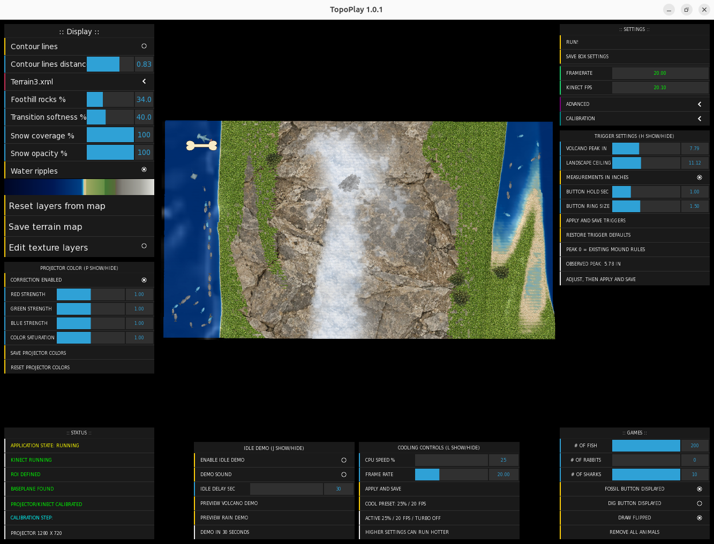
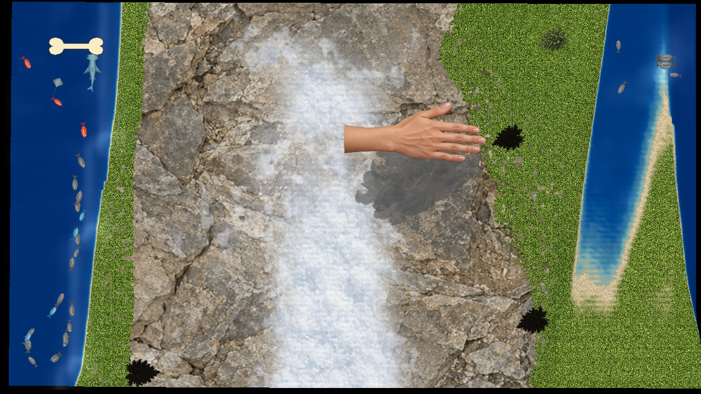
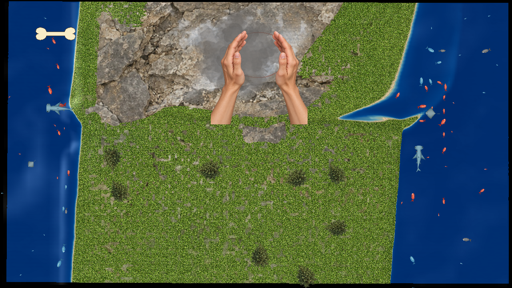

# Using TopoPlay

Start here after following the [Ubuntu installation guide](INSTALL_LINUX.md).
Keep the camera and projector fixed in position during calibration and use.

## RUN control window



The center shows a preview of the projected terrain. Surrounding panels provide
terrain appearance, projector color, calibration/status, trigger, demonstration,
performance, and animal controls. Open the image to read the controls at full size.
The values shown are example settings, not required settings for every computer.

## Demonstrations

Idle demonstrations use animated hand artwork to illustrate interactions. The
hands in these screenshots are part of the demonstration, not a live camera view
or photographs of a user's hands over the sand.

| Building a storm | Building a volcano |
| --- | --- |
|  |  |
| A hand illustrates growing a storm cloud. | Hands illustrate building a mound, with smoke over the summit. |

These are screenshots of the projector output. The resulting rain and lava
appear in the [README feature gallery](../README.md#screenshots).

## First use and settings

Keep the camera and projector rigidly mounted; room brightness can affect calibration success.
Setup/calibration starts with the color camera view; the existing controls can
switch to depth. RUN clears the camera previews and displays the projected map.
For a new box, use this order:

1. Set the projector orientation before calibration. Depending on the mounting,
   its image may need a horizontal or vertical flip. Keep that orientation fixed
   throughout calibration and normal use; recalibrate after changing it.
2. Define the **manual sandbox ROI** in the camera/depth view.
3. Start the projector/Kinect calibration. Let it finish the lower surface first.
4. At the raised-board prompt, place a flat board at least **30 mm closer to the
   Kinect**, hold it steady, and confirm to capture the upper surface.
5. Remove the board after calibration succeeds, enter **RUN**, and check the
   projected terrain against the box edges.
6. Click **Save box settings** in RUN after the alignment and controls are correct.
   Close and reopen once to confirm the saved setup.

Each calibration attempt starts with a fresh set of points. The program waits for
fresh color frames and stable depth, resolves checkerboard corner ordering, and
rejects measurements with insufficient height separation or excessive projection
error. On a failed attempt, check the camera's view and board placement, then retry.
The 30 mm requirement refers to distance toward the Kinect, rather than a fixed
board thickness.

**Show ROI** draws two depth-based projections of the same camera ROI: red uses
measured depth and green uses reference-plane depth. They do not represent the
laptop and projector separately. These outlines require a valid calibration to
be meaningful; use the camera/depth view to draw the initial ROI.

During calibration, spatial smoothing is temporarily disabled and depth buffers
are refreshed; the selected runtime filtering controls are restored afterward.
A successful calibration saves the projector mapping for your box. TopoPlay
can start RUN automatically when saved calibration and stable depth are available.

Mutable settings are in `bin/data/settings`, user terrain maps in
`bin/data/colorMaps`, and projector/performance settings alongside them under
`bin/data`. An installed folder must be writable by its user. Updates preserve
those settings and terrain maps and retain a backup of the previous installation.
Frame-rate controls are available in the application. Optional administrator-level
CPU controls require separate system configuration; the installer does not set them up.


## Fossil discoveries

Fossil mode randomly selects a T. rex, a Triceratops, a Pteranodon
(flying pterosaur), a group of three smaller skeletons, or the TopoPlay logo.
Each new round uses a random angle and 65–100% of the maximum size that safely
fits inside the sandbox ROI. The buried image stays centered and fixed while
you dig. Immediate image repeats are avoided when another readable image exists.

Turn Fossil mode off and on with the bone button or GUI to begin another round.
Allow five seconds for the starting terrain reference to settle, then dig.
The smaller skeletons in the group reveal separately as sand is removed, using
one image and one buried reference plane. This does not add automatic respawning.

Additional transparent RGBA PNGs in `bin/data/dig/fossils` join the selection
when the next round starts; no rebuild is needed. Make the space around and
between bones transparent. Keep the application folder writable. `bin/data/dig/dinotrex.png` is the fallback fossil image. See [asset
provenance](../ASSETS.md) for the generated illustrations; they are game artwork,
not scientific reconstruction diagrams.


## Projected virtual buttons

The **bone** toggles Fossil mode; the **shovel** toggles Dig mode. These are
Kinect gestures, not touch-screen buttons. Make a circle with your thumb and
finger over the icon, with its opening facing the Kinect. Hold the ring above
the configured **Landscape ceiling**, leaving the sand visible through its
center, for the **Button hold sec** interval (normally one second). Move your
hand away briefly before using it again. A flat hand covering the center is
not the intended gesture.

Use **Fossil button displayed** and **Dig button displayed** in the operator
controls to show or hide them. Hiding a button also turns off its mode. Fossil
and Dig are mutually exclusive. The icon is green while its mode is active;
a yellow outline indicates the ring gesture is being detected. See
[the full virtual-button guide](VIRTUAL-BUTTONS.md) for placement, height,
hold settings and troubleshooting.


## Closing TopoPlay

Close the operator GUI with its X button to quit the whole application, including
the projector window and Kinect acquisition. Minimizing the GUI or closing the
laptop lid does not request an application exit; GNOME projector
handling continues. Check with `pgrep -a -x TopoPlay` after closing the GUI.


## Optional desktop shortcut

The installer asks whether to create a desktop shortcut. Declining keeps the
application-menu entry. Use `--desktop-shortcut` or `--no-desktop-shortcut` for an
explicit choice; noninteractive runs skip creating it unless requested. Existing
installer-managed shortcuts are refreshed on updates. No startup entry is added.

To add the shortcut later, from the installed folder run:

```bash
python3 scripts/install.py --register-only --desktop-shortcut
```

The installer uses your configured desktop folder and marks the launcher executable.
On Ubuntu you may need to right-click it and choose **Allow Launching**. Desktop
icons must be enabled by the desktop environment; the installer does not change
extensions or system preferences. The shortcut uses the bundled TopoPlay logo when available.
Removing registration also removes this installation's managed desktop shortcut.

